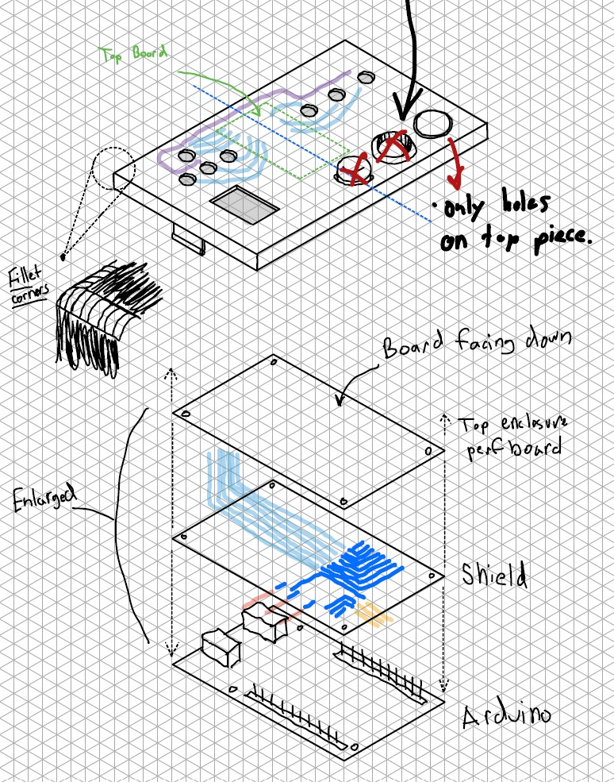
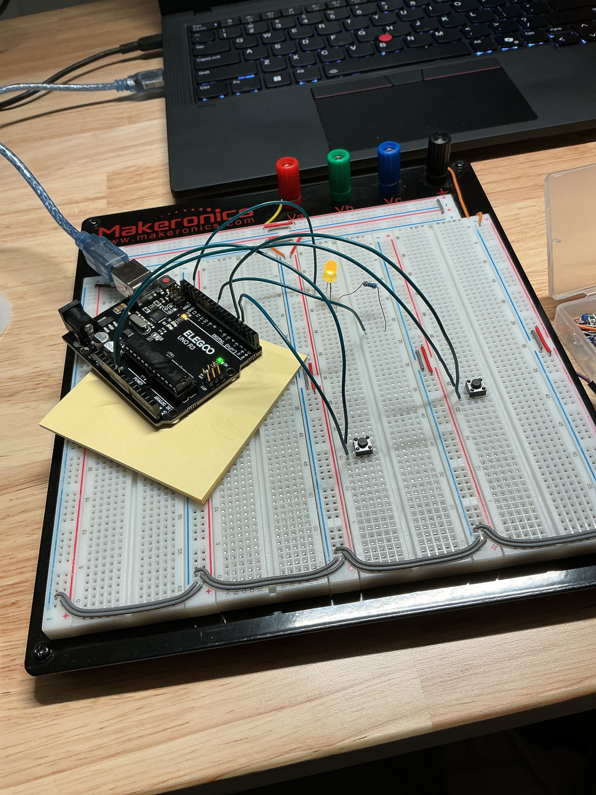
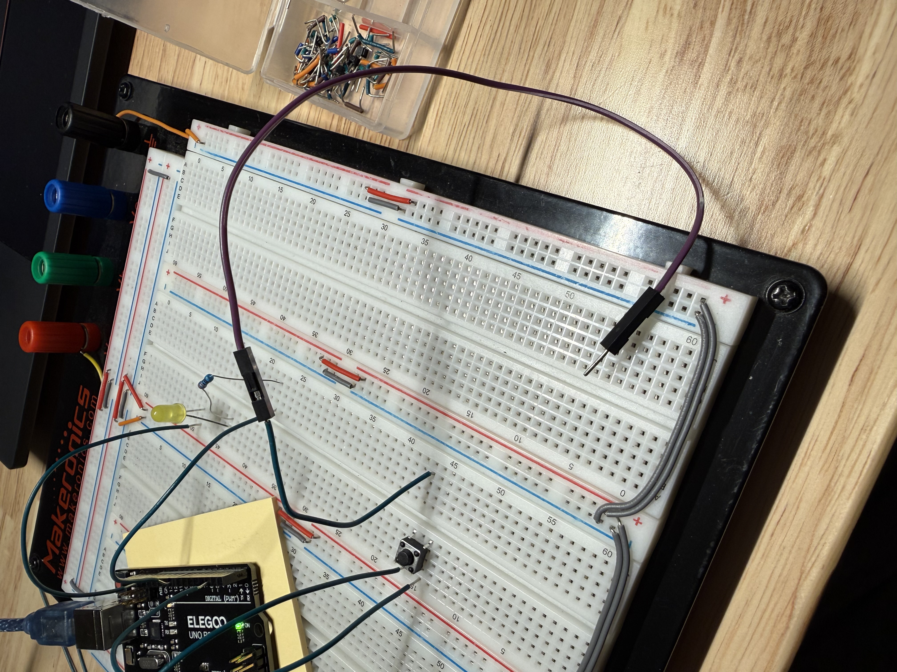
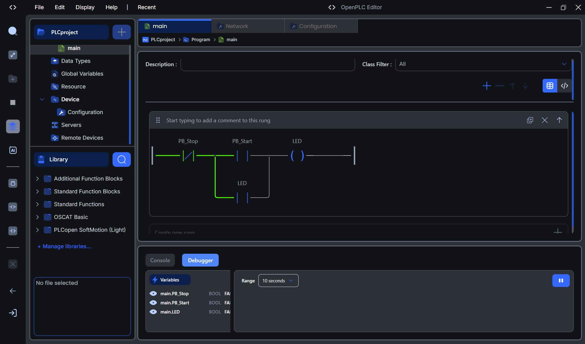
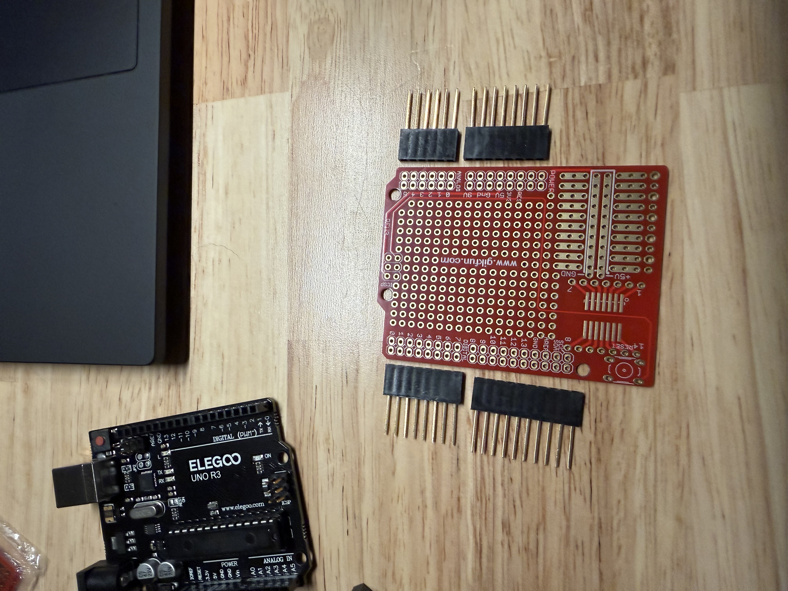
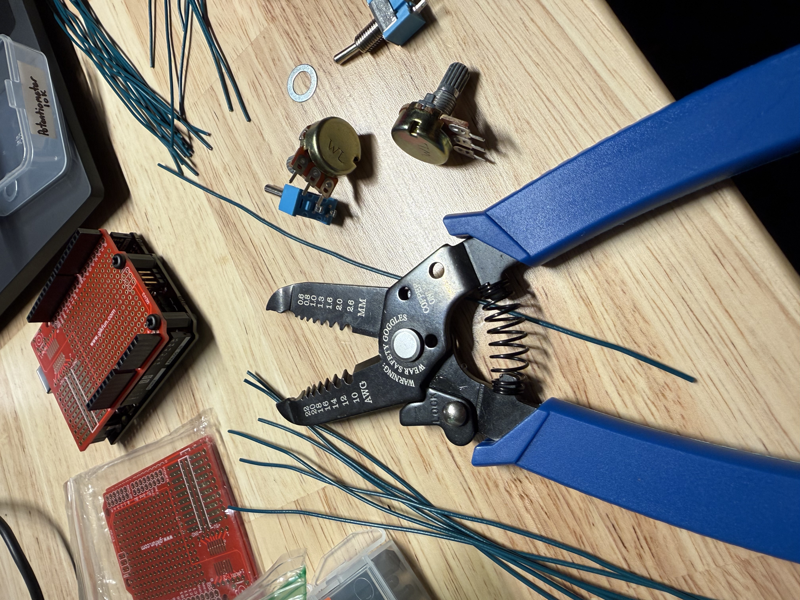
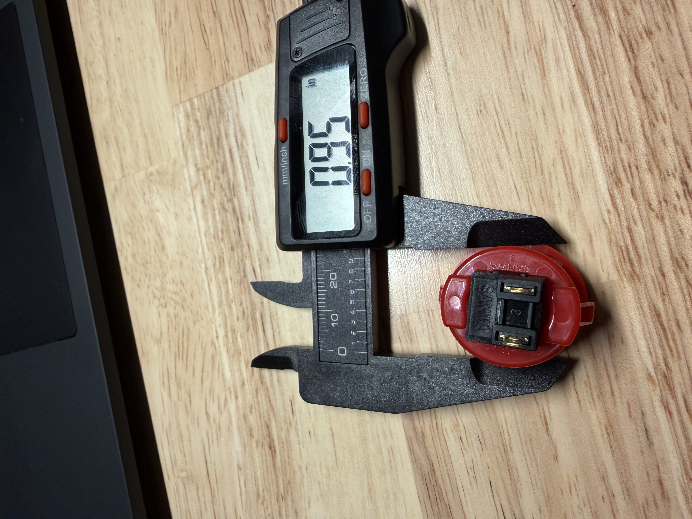
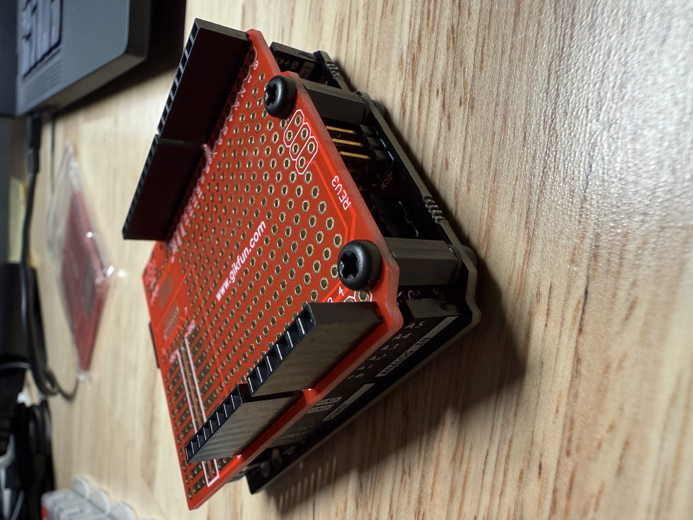

# OpenPLC Arduino Handheld Trainer (In Progress)

> Building a portable, ruggedized industrial automation trainer powered by an Arduino Uno R3 running OpenPLC ladder logic, paired with a custom shield.

## Overview
* **Status:** 🚧 Active Development / In Progress
* **Core Technology:** Arduino Uno R3, OpenPLC Editor, Ladder Logic, Custom Perfboard Shield, 3D CAD
* **Primary Objective:** Create a self-contained, reliable handheld PLC training unit to test automation concepts without dragging out full-scale industrial hardware.

---

## Engineering Journey & Problem-Solving
* **Initial Prototyping:** Validated base logic on a standard breadboard using OpenPLC ladder programming.
* **Troubleshooting:** Identified that loose jumper connections caused intermittent faults, making it unsuitable for a handheld or field-portable unit.
* **Shield Solution:** Dedicated perfboard shield utilizing long female pin headers and mechanical standoffs to create a secure, modular stack directly on the Arduino.
* **Fabrication Prep:** Precision-measured components with digital calipers and prepped custom-cut wiring harnesses for clean soldering.

---

## Build Gallery
| Initial Breadboard Concept | Wiring Challenges & Issues | OpenPLC Ladder Logic |
| :---: | :---: | :---: |
|  |  |  |

| Custom Shield Solution | Soldering & Wire Prep | Component Measurement |
| :---: | :---: | :---: |
|  |  |  |

| Mechanical Dry Assembly | 
| :---: | 
|  | 

---

## Active Todo List / Next Steps
- [ ] Complete permanent soldering of the custom Arduino shield.
- [ ] Finalize enclosure design and mount the hardware stack.
- [ ] Expand OpenPLC ladder logic program for multi-input/output training exercises.
- [ ] Upload compiled source code (`.ino` / OpenPLC files) to the `src/` directory.
